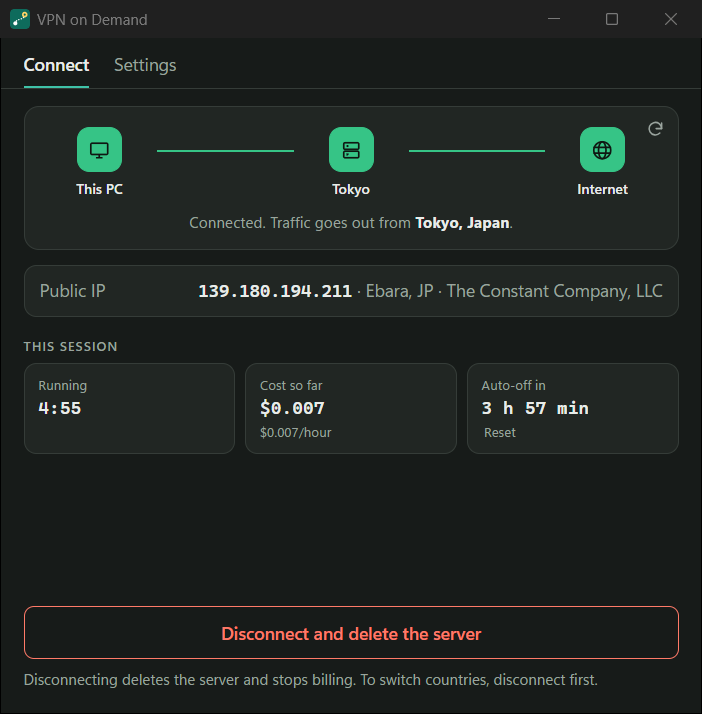
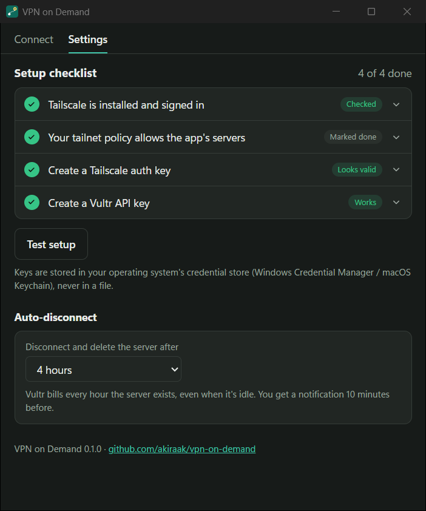
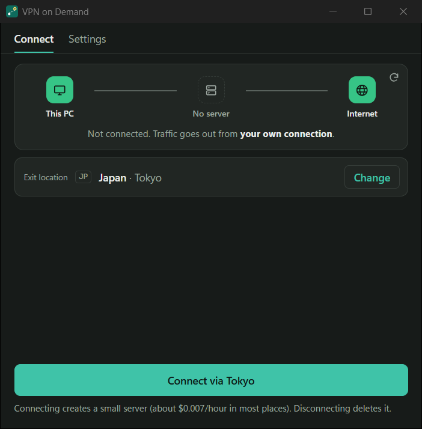

# VPN on Demand

A personal VPN that exists only while you use it.

Pick a country and press **Connect**. The app creates a small server in that country on
[Vultr](https://www.vultr.com/), makes it a [Tailscale](https://tailscale.com/) exit node, and
sends your PC's internet traffic through it. Press **Disconnect** and the server is deleted.
You pay Vultr for the hours the server existed (about $0.007 per hour) and nothing in the months
you don't use it.

- **Your own server.** Nobody else shares the IP address, and there is no VPN company in between.
- **About 20 countries.** Every Vultr location is available (more than 30 cities).
- **No VPN driver of its own.** Tailscale carries the traffic. The app only creates the server and
  switches Tailscale's exit node.
- **Built not to leave a server running.** It disconnects by itself after a few hours, warns you
  when you quit, and finds a leftover server the next time it starts.

<p align="center"></p>

It was made to watch Japan-only streaming sites from outside Japan, as a replacement for a
commercial VPN subscription.

> **Status:** Windows 10 and 11 (64-bit). A macOS version is planned.

## Contents

- [How it works](#how-it-works)
- [What it costs](#what-it-costs)
- [What you need](#what-you-need)
- [Setup](#setup)
- [Using the app](#using-the-app)
- [Making sure nothing is left running](#making-sure-nothing-is-left-running)
- [Troubleshooting](#troubleshooting)
- [Updating](#updating)
- [Uninstalling and cleaning up](#uninstalling-and-cleaning-up)
- [Security notes](#security-notes)
- [Building from source](#building-from-source)

## How it works

```
This PC ── Tailscale ──▶ your server on Vultr (exit node) ──▶ Internet
```

**Connect** does this, in about a minute and a half:

1. Creates the smallest Vultr server in the location you chose.
2. The server installs Tailscale on first boot and joins your tailnet as an exit node.
3. The app switches this PC's Tailscale exit node to the server and shows the new public IP
   address.

**Disconnect** turns the exit node off and deletes the server. It takes a few seconds.

### What it is not

- **Not an anonymity tool.** The server is rented in your name, and Vultr knows who you are.
- **Not a guarantee for streaming.** The IP address belongs to a data center, and a site can block
  it at any time. Reconnecting gives you a new server with a different address, which sometimes
  helps. Whether using a VPN is allowed is up to each site's terms of service.
- **Not instant.** If you need a VPN that connects in two seconds, a subscription VPN is a better
  fit.

## What it costs

| | |
|---|---|
| The app | Free, open source (MIT) |
| Tailscale | Free on the Personal plan |
| Vultr | About **$0.007 per hour** while a server exists (the smallest plan; a few locations cost a little more). The app shows the cost of the current session. |

Two hours of video costs about one and a half cents. Vultr asks for a payment method when you sign
up, and may ask for a small deposit.

Vultr bills for every hour a server **exists**, including when it is idle. The server is deleted,
not stopped, when you disconnect. See
[Making sure nothing is left running](#making-sure-nothing-is-left-running).

## What you need

- A PC with Windows 10 or 11 (64-bit)
- A [Tailscale](https://tailscale.com/) account, and Tailscale installed on the PC
- A [Vultr](https://www.vultr.com/) account with a payment method

Setup takes about 10 minutes, once.

## Setup

The app's **Settings** tab has the same steps as a checklist, with links and a **Test setup**
button. You can follow them there or here.

### 1. Install Tailscale and sign in

Download Tailscale from [tailscale.com/download](https://tailscale.com/download), install it, and
sign in. If you don't have an account, signing in creates one. Your account's private network is
called your *tailnet*.

### 2. Let the app's servers become exit nodes

Every connection creates a new server, and Tailscale normally asks you to approve each new exit
node by hand. This step approves the app's servers automatically, and only them.

Open [Access controls](https://login.tailscale.com/admin/acls/file) in the Tailscale admin
console. Switch to the JSON editor if you see the visual editor. Add these two sections at the top
level of the file. If `tagOwners` or `autoApprovers` already exists, add the line inside it
instead.

```json
"tagOwners": {
  "tag:vpn-on-demand": ["autogroup:admin"]
},
"autoApprovers": {
  "exitNode": ["tag:vpn-on-demand"]
}
```

Save the file.

### 3. Create a Tailscale auth key

The server uses this key to join your tailnet.

Open [Settings → Keys](https://login.tailscale.com/admin/settings/keys) and choose
**Generate auth key**. Then:

- Turn on **Reusable**
- Turn on **Ephemeral** (a deleted server then disappears from your tailnet by itself)
- Turn on **Tags** and add `tag:vpn-on-demand`
- Pick an expiration. The longest is 90 days

Copy the key (it starts with `tskey-auth-`). It is shown only once. You will paste it into the app
in step 6.

When the key expires, create a new one the same way and save it in the app.

### 4. Create a Vultr API key

The app uses this key to create and delete the server.

1. Sign up at [vultr.com](https://www.vultr.com/) and add a payment method.
2. Open [Account → API](https://my.vultr.com/settings/#settingsapi) and enable the API.
3. Under **Access Control**, choose **Allow all IPv4** and **Allow all IPv6**.
4. Copy the API key.

Why allow all addresses: while you are connected, your traffic leaves from the server's address,
not your home address. A rule that allows only your home address would block the app exactly when
it needs to check on the server.

This key can do anything in your Vultr account. Treat it like a password.

### 5. Install the app

Download `VPN.on.Demand_x.y.z_x64-setup.exe` from the
[latest release](https://github.com/akiraak/vpn-on-demand/releases/latest) and run it.

The installer is not code-signed, so Windows shows warnings:

- Your browser may say the file isn't commonly downloaded. Choose **Keep** (in Edge: **…** →
  **Keep** → **Keep anyway**).
- When you run it, Windows shows **Windows protected your PC**. Click **More info**, then
  **Run anyway**.

The app installs for the current user only and doesn't ask for administrator rights.

### 6. Enter the keys and test

Start **VPN on Demand**. The first time, it opens the **Settings** tab.

1. Open **Your tailnet policy allows the app's servers** and press **Mark as done** (you did this
   in step 2; the app can't check it for you).
2. Open **Create a Tailscale auth key**, paste the key, and press **Save**.
3. Open **Create a Vultr API key**, paste the key, and press **Save**.
4. Press **Test setup**. Each step shows a check mark or says what is wrong.

The keys are saved in Windows Credential Manager, not in a file.

<p align="center"></p>

## Using the app

### Connect

<p align="center"></p>

1. On the **Connect** tab, **Exit location** shows where the server will be. Press **Change** to
   pick another country. Countries with several locations (the United States, for example) let
   you choose a city.
2. Press **Connect via …**. The steps are shown as they happen. It usually takes about a minute
   and a half. You can cancel at any time; the server is deleted.
3. When it is connected, the app shows your new public IP address, how long the server has been
   running, and the cost so far.

All internet traffic from this PC now goes through the server. Devices on your local network
(printers, a NAS) stay reachable.

You can close the window. The app keeps running in the system tray, and the tray icon shows the
state. Right-click it for **Connect**, **Disconnect**, and **Quit**.

### Disconnect

Press **Disconnect and delete the server**. Your traffic goes back to your own connection, and
billing stops.

To switch to another country, disconnect first, then connect to the new one.

### Auto-disconnect

So that a forgotten server doesn't keep costing money, the app disconnects and deletes the server
by itself after **4 hours**. You get a notification 10 minutes before. Press **Reset** next to
**Auto-off in** to start the timer again.

You can change the time (1 to 24 hours, or never) under **Settings → Auto-disconnect**.

The timer only runs while the app is running. See the next section.

## Making sure nothing is left running

A server costs money for as long as it exists, so the app is careful about deleting it:

- **Disconnect** checks that the server is really gone, and tells you if it isn't.
- **Quit** while a server exists asks whether to delete it first.
- **When it starts**, the app looks in your Vultr account for a server it created earlier, and
  tells you if one is still there. It doesn't rely on a local record, so this works even after a
  crash or a reinstall.

What the app can't cover: if the PC is turned off, goes to sleep, or the app is closed with
**Quit and keep it running**, nothing deletes the server until you start the app again.

To check for yourself, open [my.vultr.com](https://my.vultr.com/). The app's servers are named
`vpn-on-demand-` followed by the location (for example `vpn-on-demand-nrt`) and carry the tag
`vpn-on-demand`. If one is there and you aren't using it, press **Disconnect** in the app, or
delete it on that page (**Server Destroy**).

## Troubleshooting

**"Tailscale is not installed" / "Tailscale is not connected"**
Install Tailscale, open it, and sign in. Then press the refresh button on the **Connect** tab.

**"Vultr rejected the API key"**
Check that the key in **Settings** is the current one, and that **Access Control** on Vultr's API
page allows all IPv4 and IPv6 addresses ([step 4](#4-create-a-vultr-api-key)).

**The app stays at "Waiting for approval as an exit node"**
The tailnet policy from [step 2](#2-let-the-apps-servers-become-exit-nodes) is missing or not
saved, or the auth key doesn't have the tag `tag:vpn-on-demand`. To get going right now, open
[Machines](https://login.tailscale.com/admin/machines) in the Tailscale admin console, find the
`vpn-on-demand-…` machine, choose **Edit route settings**, and turn on **Use as exit node**. Then
fix the policy or the key so that you don't have to do it every time.

**"The server didn't join your tailnet within … minutes"**
The auth key is most likely expired, not reusable, or was revoked. Create a new one
([step 3](#3-create-a-tailscale-auth-key)) and save it in **Settings**. The app deletes the server
that failed to join.

**"No small server plan is available in … right now"**
That location is full at the moment. Pick another city or country.

**"These servers still exist" after Disconnect**
Press **Disconnect** again. If it keeps failing, delete the server at
[my.vultr.com](https://my.vultr.com/).

**A streaming site says you are using a VPN, or shows the wrong country**
Disconnect and connect again to get a server with a different IP address. Some sites block data
center addresses altogether, and then this app can't help.

**The connection drops for a few seconds right after connecting or disconnecting**
That is the moment Tailscale changes the route. It comes back by itself.

**You already use another Tailscale exit node**
Connecting switches this PC to the app's server, and disconnecting turns the exit node off. Choose
your other exit node again in Tailscale afterwards.

For anything else, please [open an issue](https://github.com/akiraak/vpn-on-demand/issues). Don't
include your keys.

## Updating

The app doesn't update itself. Disconnect, quit the app from the tray menu, then download and run
the installer of the
[latest release](https://github.com/akiraak/vpn-on-demand/releases/latest). Your settings and keys
are kept.

## Uninstalling and cleaning up

1. **Disconnect**, and check at [my.vultr.com](https://my.vultr.com/) that no `vpn-on-demand-…`
   server is left.
2. In the app's **Settings**, press **Remove** next to both keys. This deletes them from Windows
   Credential Manager.
3. Quit the app from the tray menu.
4. Uninstall **VPN on Demand** in Windows **Settings → Apps → Installed apps**.
5. Delete these two folders if they are still there. Paste each path into the address bar of
   File Explorer to find it.
   - `%APPDATA%\io.github.akiraak.vpn-on-demand` (the non-secret settings)
   - `%LOCALAPPDATA%\io.github.akiraak.vpn-on-demand` (the cache of the app's window)

If you won't use the app again, also revoke what you created for it:

- Tailscale: revoke the auth key in
  [Settings → Keys](https://login.tailscale.com/admin/settings/keys), and remove the
  `tag:vpn-on-demand` lines from [Access controls](https://login.tailscale.com/admin/acls/file).
- Vultr: regenerate or disable the API key in
  [Account → API](https://my.vultr.com/settings/#settingsapi).

## Security notes

- **Where the keys are.** Both keys are stored in the operating system's credential store (Windows
  Credential Manager). They are not written to a settings file, and the app shows them masked.
- **The Vultr API key has full access to your Vultr account.** Vultr doesn't offer keys with
  limited rights. The app talks only to Vultr's API, and never sends the key anywhere else,
  including to the server it creates.
- **The Tailscale auth key is sent to the server.** It is part of the server's startup script,
  which Vultr stores for as long as the server exists. The server is yours and lives for a few
  hours, but use a key that is tagged `tag:vpn-on-demand` and has an expiration, as described in
  [step 3](#3-create-a-tailscale-auth-key), so that it can't be used for anything else.
- **The server is closed from the internet.** Its public SSH port is blocked. Tailscale SSH is
  enabled, and who can use it is decided by your tailnet policy.
- **The server can reach what your tailnet policy lets it reach.** With Tailscale's default
  policy, every machine in your tailnet can talk to every other one, and that includes the app's
  server. If you want to restrict it, write rules for `tag:vpn-on-demand` in your policy.
- **The app has no server of its own and collects no data.** It talks to Vultr's API, to
  Tailscale on your PC, and to [ipinfo.io](https://ipinfo.io/) to show your public IP address.

## Building from source

The app is built with [Tauri 2](https://tauri.app/): Rust for the logic, TypeScript for the
window. You need Rust, Node.js 22, and Tauri's
[prerequisites](https://tauri.app/start/prerequisites/) for your system.

```bash
cd app
npm install
npm run tauri dev                         # run it
(cd src-tauri && cargo test)              # unit tests
npm run tauri build -- --bundles nsis     # Windows installer
```

Release installers are built by GitHub Actions
([release.yml](.github/workflows/release.yml)) from a version tag.

The project notes (design decisions, plans, and how to cross-build the Windows installer on Linux)
are in [CLAUDE.md](CLAUDE.md) and [docs/plans](docs/plans), in Japanese.

## License

[MIT](LICENSE)
